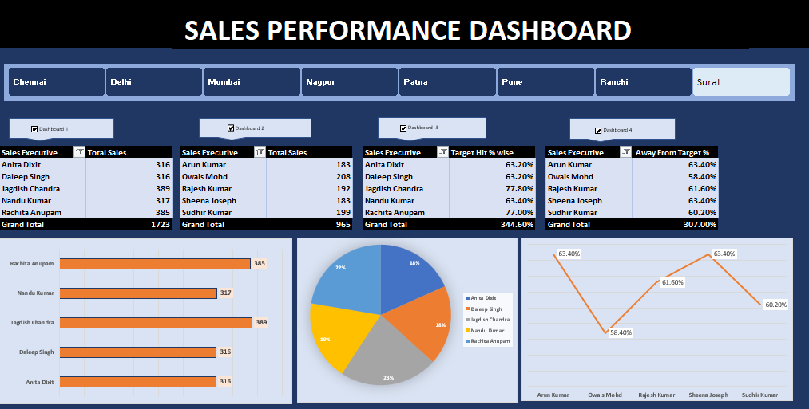

# Sales Performance Dashboard | Excel & VBA

## Project Overview
Developed an interactive Sales Performance Dashboard using Microsoft Excel to analyze regional sales and sales executive performance.

## Tools & Technologies
- Microsoft Excel
- PivotTables and Pivot Charts
- Slicers
- VBA Macros
- Data Analysis and Visualization

## Key Features
- Interactive region-wise filtering using slicers.
- Sales performance comparison across sales executives.
- Target achievement and performance analysis.
- Bar, pie, and line chart visualizations.
- VBA macro automation to connect or disconnect PivotTables from the region slicer based on checkbox-linked TRUE/FALSE values.

## Dashboard Preview

## Key Learning Outcomes
- Improved Excel dashboard design and data visualization skills.
- Learned to use PivotTables and slicers for interactive reporting.
- Practiced VBA automation to manage slicer connections across multiple PivotTables.

## How to Use
1. Download the Excel workbook.
2. Open it in desktop Microsoft Excel.
3. Enable macros only if you trust the workbook and its source.
4. Use the region slicer to explore the dashboard.
